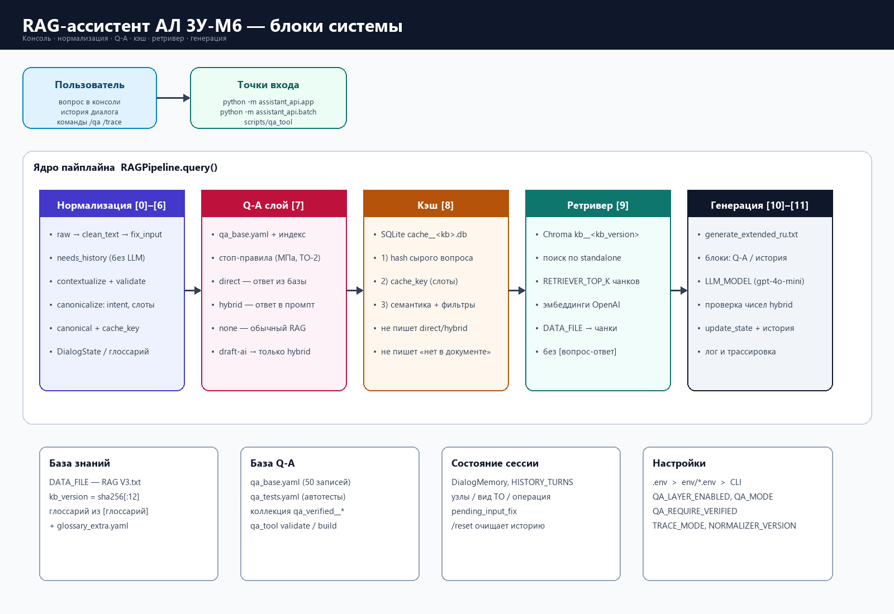

# RAG-ассистент АЛ 3У-М6

Консольный RAG по руководству ТО автолифта **АЛ 3У-М6** (`assistant_api`). Каталог `assistant_giga/` не используется.

Полное описание шагов [0]–[11], переменных и `qa_tool` — **[assistant_api/README.md](assistant_api/README.md)**. ТЗ — `docs/ТЗ-RAG-AL.md`.

## Схемы

Блоки системы:



Этапы обработки запроса (подробно):

![Этапы [0]–[11]](docs/diagrams/request_pipeline.png)

PNG: `docs/diagrams/assistant_blocks.png`, `docs/diagrams/request_pipeline.png`. Пересборка: `python scripts/render_readme_diagrams.py`.

## Запуск (Windows)

```powershell
.\venv_py311\Scripts\python.exe -m assistant_api.app --trace full
```

В `.env` нужны `OPENAI_API_KEY`, для Q-A в консоли — `QA_LAYER_ENABLED=true` и `QA_MODE=full`. После смены `.env` перезапустите процесс.

| Команда | Действие |
|---|---|
| `/qa full` | включить уровень Q-A в текущей сессии |
| `/trace full` | полная трасса [0]–[11] |
| `/reset` | очистить историю |
| `clear` | очистить кэш |

`verified_by: draft-ai` при `QA_REQUIRE_VERIFIED=true` даёт `hybrid` (LLM вызывается). В тестах прямой ответ: `python scripts/qa_tool test --ignore-verified --mode full`.

## Индекс Q-A и база знаний

```powershell
.\venv_py311\Scripts\python.exe scripts\qa_tool build
.\venv_py311\Scripts\python.exe -m assistant_api.app --rebuild-kb --trace full
```

Источник фактов: `ТО автолифта АЛ 3У-М6 — версия для RAG V3.txt`. Строк `[вопрос-ответ]` в индексе нет.
