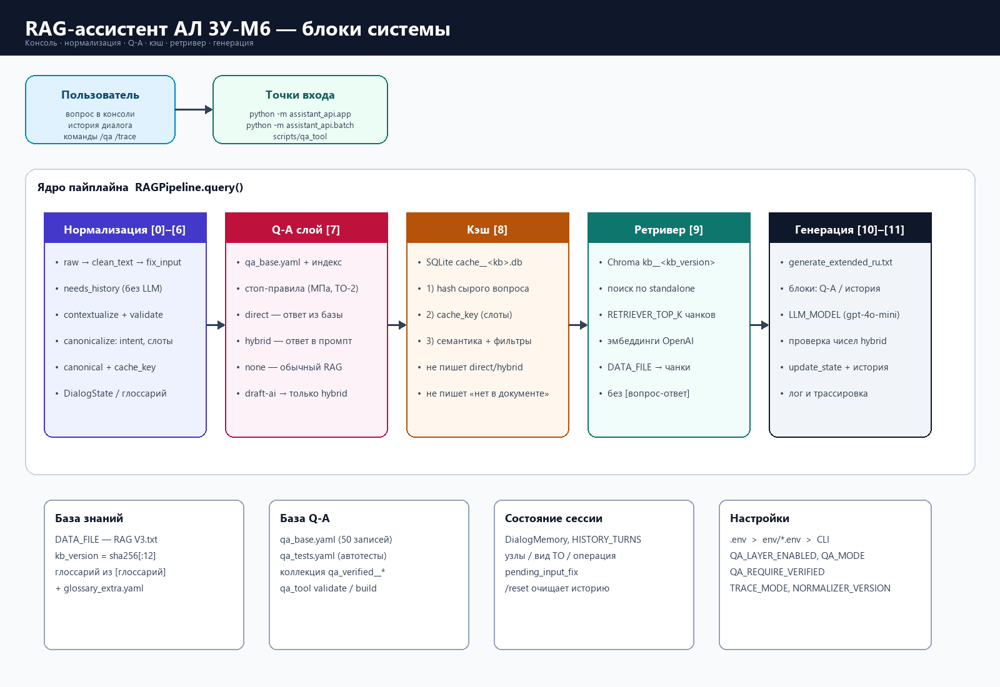
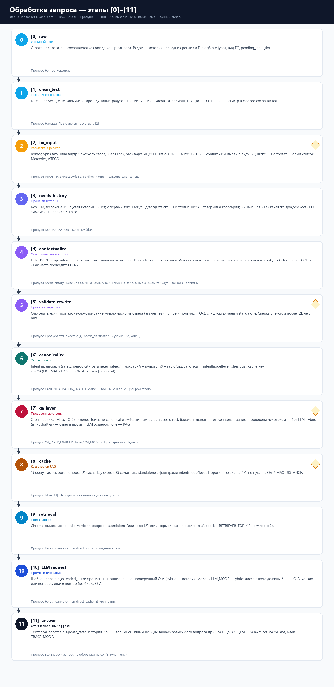

# RAG-ассистент АЛ 3У-М6: обработка запросов

Актуальная документация ветки `assistant_api` (требования — ТЗ-RAG-AL, раздел 20). Заготовка — `TZ-RAG-AL/README_RAG-AL.md`.

Все факты о технике в примерах взяты из `ТО автолифта АЛ 3У-М6 — версия для RAG V3.txt` (`DATA_FILE`). Параметров, которых нет в документе (давление в МПа, моменты затяжки в Н·м, ТО-2), ассистент не знает и не должен придумывать.

Каталог `assistant_giga/` к этой ветке не относится и не изменяется. Файл «вопросы и ответы (TXT)» в Chroma не индексируется.

**Схемы (PNG):**

| Файл | Содержание |
|---|---|
| [`docs/diagrams/assistant_blocks.png`](../docs/diagrams/assistant_blocks.png) | Блоки системы: входы, ядро пайплайна, хранилища |
| [`docs/diagrams/request_pipeline.png`](../docs/diagrams/request_pipeline.png) | Этапы [0]–[11] с входом, выходом и условиями пропуска |

Пересборка схем: `python scripts/render_readme_diagrams.py`.

## Содержание

1. Назначение
2. Схема обработки запроса
3. Этапы обработки по шагам [0]–[11]
4. Сквозные примеры
5. Режим трассировки
6. Переменные окружения
7. Запуск: консоль, пакетный прогон, `qa_tool`
8. Кэш
9. Уровень проверенных ответов (Q-A)
10. Глоссарий, белый список латиницы и версии
11. Оценка качества
12. Файлы проекта

## 1. Назначение

Ассистент отвечает на вопросы по техническому обслуживанию автолифта АЛ 3У-М6. Источник знаний — один текстовый файл (`DATA_FILE`), разбитый на чанки и проиндексированный в Chroma. Перед поиском вопрос проходит нормализацию: исправление раскладки и регистра, восстановление контекста из истории, канонический вид. Часть вопросов закрывается проверенными ответами (уровень Q-A).

`direct` отдаёт текст из `qa_base.yaml` без генерации. Записи с `verified_by: draft-ai` при `QA_REQUIRE_VERIFIED=true` дают максимум `hybrid`: проверенный ответ идёт в промпт, LLM всё равно вызывается.

## 2. Схема обработки запроса





```
вопрос пользователя + история + DialogState
  │
  [0] raw               исходный текст, без изменений
  [1] clean_text        Unicode, пробелы, ё→е, единицы, варианты ТО
  [2] fix_input         homoglyph, Caps Lock, латинская раскладка
  │     confirm → «Вы имели в виду…?» → конец
  [3] needs_history     нужна ли история (правила, без LLM)
  [4] contextualize     LLM: зависимый вопрос → standalone
  [5] validate_rewrite  числа, отрицания, утечка ответа, ТО-2
  │     needs_clarification → уточнение, конец
  [6] canonicalize      слоты → canonical, cache_key
  [7] qa_layer          direct / hybrid / none
  │     direct → [11]
  [8] cache             query_hash → cache_key → семантика
  │     hit → [11]
  [9] retrieval         чанки по standalone
  [10] LLM request      generate_extended_ru.txt
  [11] answer           ответ, update_state, история, кэш, лог
```

Номер шага (`step_id`) одинаков в коде, логе, трассировке и в этом README. **`пропущен` в трассе** — шаг не вызывался (не ошибка).

## 3. Этапы обработки

### [0] Исходный ввод

- **Вход:** строка пользователя, история, `DialogState`.
- **Выход:** `raw` без изменений.
- **Пропуск:** нет.

### [1] clean_text

- NFKC, пробелы, ё→е, кавычки и тире; единицы («градусов» → `°C`, «минут» → `мин`, «часов» → `ч`); варианты ТО из `glossary_extra.yaml` (`то-1` → `ТО-1`, «сезонное» → `СО`).
- **Регистр** в `cleaned` / `standalone` сохраняется. Нижний регистр — внутри `tokenize()`, правил intent и канонизации.
- **Пропуск:** нет. Повторяется после [2].

### [2] fix_input

- `homoglyph` — латинские буквы внутри русского слова; `capslock` — инвертированный регистр или весь текст ЗАГЛАВНЫМИ; `layout` — ЙЦУКЕН.
- `ratio` ≥ `LAYOUT_AUTO_MIN_RATIO` (0.8) → `auto`; 0.5–0.8 → `LAYOUT_UNCLEAR_ACTION` (`confirm` / `answer_with_note` / `ignore`); ниже — не исправлять.
- При `confirm`: «Похоже, вопрос набран в латинской раскладке…». «да» / «Lf» обрабатывает сохранённый вопрос.
- **Пропуск:** `INPUT_FIX_ENABLED=false`. При выключенной нормализации шаг всё равно работает.

### [3] needs_history

По токенам, первое сработавшее правило:

1. история пустая → нет;
2. первый токен «а», «и», «еще», «тогда», «также» → да;
3. местоимение / указатель → да;
4. нет предметного термина глоссария (сравнение по леммам) → да;
5. иначе → нет.

«Так какая же трудоемкость ЕО зимой?» при непустой истории → правило 5 (`False`), шаги [4]–[5] пропускаются.

**Пропуск:** `NORMALIZATION_ENABLED=false`.

### [4] contextualize

LLM (`NORMALIZER_MODEL`, `temperature=0`, JSON) переписывает зависимый вопрос. В `standalone` переносится **объект** из истории, **не числа из ответа**. Таймаут / битый JSON → fallback на текст после [2].

**Пропуск:** `needs_history=False` или `CONTEXTUALIZATION_ENABLED=false`.

### [5] validate_rewrite

Fallback на текст [2], если пропало число или отрицание, появилось число из ответа ассистента (`answer_leak_number`), появился ТО-2, слишком длинный `standalone`. Сверка с текстом после [2], не с `raw`.

`needs_clarification` → уточнение, [6]–[10] не выполняются, в кэш не пишется.

### [6] canonicalize

Лемматизация (`pymorphy3`), глоссарий, `rapidfuzz` (`FUZZY_CUTOFF`). Intent правилами (0 предельное значение → 7 `other`). Период: «два раза в год» → `2/год`; вопросительные формы значения не дают.

`canonical` — слоты через `|`; `cache_key = sha256(NORMALIZER_VERSION | kb_version | canonical)`. Сейчас `NORMALIZER_VERSION=2`.

### [7] Уровень Q-A

Стоп-правила (МПа, ТО-2) → `none`. Затем canonical / семантика paraphrases, слоты, отрыв `margin`.

| Решение | Когда | LLM |
|---|---|---|
| `direct` | близко, margin, тот же intent, запись **не** `draft-ai` (если `QA_REQUIRE_VERIFIED=true`) | нет |
| `hybrid` | в пределах `QA_HYBRID_MAX_DISTANCE`, или `draft-ai`, или `intent_mismatch` | да, ответ Q-A в промпте |
| `none` | нет кандидата | обычный RAG |

`QA_MODE`: `off` | `shadow` | `hybrid_only` | `full`. В консоли: `/qa full`.

**Пропуск:** `QA_LAYER_ENABLED=false`, `QA_MODE=off`, устаревший `kb_version` в манифесте.

### [8] Кэш

Порядок lookup:

1. точный `query_hash` сырого вопроса (повтор той же строки, в том числе после fallback);
2. `cache_key` канона;
3. семантика `standalone` с фильтрами `intent` / `node` / `maintenance_level` / `normalizer_version` / `kb_version`.

Пороги кэша — **сходство** (`SEMANTIC_CACHE_MIN_SIMILARITY=0.88`, `SEMANTIC_CACHE_STRICT_MIN_SIMILARITY=0.97`). Пороги Q-A — **расстояние** (`QA_*_MAX_DISTANCE`). Значения не переносить.

Не кэшируются: уточнения; `direct` / `hybrid`; ответы «нет информации»; fallback зависимого вопроса в **канонический** ключ при `CACHE_STORE_FALLBACK=false` (сырой хеш при этом можно сохранить).

### [9] Ретривер

`RETRIEVER_TOP_K` чанков (в `.env` часто **3**) по `standalone` в коллекции `kb__<kb_version>`.

### [10] Генерация

Шаблон `prompts/generate_extended_ru.txt`: чанки; при `hybrid` — проверенный ответ; при нормализации — история. `QA_HYBRID_NUMBER_CHECK`: число с единицей в ответе модели должно быть в Q-A, фрагментах или вопросе; иначе повтор без блока Q-A.

### [11] Ответ

Текст пользователю, `update_state()`, история, кэш (если разрешено), `PIPELINE_LOG_FILE`, трассировка.

## 4. Сквозные примеры

**Самостоятельный вопрос (история пустая)**

```
[0] «Какая наработка гидросистемы до ТО-1?»
[3] needs_history=False (правило 1)
[6] periodicity | гидросистема | ТО-1 | residual=наработка
[7] hybrid qa003 draft-ai     ← LLM вызывается
[11] «…250 ч работы гидросистемы (или через 2 месяца)…»
```

**Эллипсис**

История: периодичность ТО-1. Вопрос: «А для СО?»

```
[3] True (правило 2)
[4] standalone «Как часто проводится сезонное обслуживание (СО)?»
[7] hybrid qa004
```

**Латинская раскладка:** `Rfr xfcnj ghjdjlbncz NJ-1&` → [2] auto «Как часто проводится ТО-1?».

**Вне документа:** «Когда проводится ТО-2?» → [7] `none` / `level_out_of_corpus` → RAG говорит, что в документе ЕО, ТО-1 и СО.

## 5. Режим трассировки

`TRACE_MODE=summary|full`, флаг `--trace`, в консоли `/trace full`, `/trace last`.

Длинные поля — `TRACE_MAX_CHARS`; ключи API маскируются.

## 6. Переменные окружения

**Приоритет:** флаг CLI > переменная процесса > `ENV_FILE` > `.env` > `settings.py`.

| Профиль | Назначение |
|---|---|
| `env/baseline.env` | нормализация, ввод и Q-A выключены |
| `env/normalize.env` | нормализация без Q-A |
| `env/qa_shadow.env` | Q-A только в лог |
| `env/full.env` | всё включено, `QA_MODE=full` |
| `env/debug.env` | как full + `TRACE_MODE=full` |

```powershell
$env:ENV_FILE="env/debug.env"; .\venv_py311\Scripts\python.exe -m assistant_api.app
.\venv_py311\Scripts\python.exe -m assistant_api.app --print-config
```

Полная таблица — `env.example` (из `settings.py` скриптом `scripts/gen_env_docs.py`).

Типичные значения для консоли: `QA_LAYER_ENABLED=true`, `QA_MODE=full`, `QA_REQUIRE_VERIFIED=true`, `QA_TOP_K=15`, `NORMALIZER_VERSION=2`.

## 7. Запуск

Из корня репозитория, интерпретатор `venv_py311`. Нужен `OPENAI_API_KEY` в `.env`.

### Консоль

```powershell
.\venv_py311\Scripts\python.exe -m assistant_api.app --trace full
```

При смене `.env` процесс нужно перезапустить (кроме `/qa` и `/trace` в текущей сессии).

| Команда | Действие |
|---|---|
| `/reset` | история и `DialogState` |
| `/state` | текущее состояние |
| `/trace off\|summary\|full` | режим до конца сессии |
| `/trace last` | последний блок |
| `/config` | значения и источник |
| `/qa off\|shadow\|hybrid_only\|full` | режим Q-A до конца сессии |
| `clear` | очистить кэш |
| `stats` | статистика коллекций |
| `exit` | выход |

Первый запуск индексирует Chroma (`kb__<kb_version>`). Пересборка: `--rebuild-kb`.

### Пакетный прогон

```powershell
.\venv_py311\Scripts\python.exe -m assistant_api.batch --input tests\fixtures\batch_example.yaml --stage full
.\venv_py311\Scripts\python.exe -m assistant_api.batch --input questions.txt --stage normalize --trace
```

Стадии: `input_fix` [0]–[2], `normalize` [0]–[6], `qa` [0]–[7], `retrieve` [0]–[9], `full` [0]–[11]. Отчёты — `reports/batch/<дата_время>/`.

### qa_tool

```powershell
.\venv_py311\Scripts\python.exe scripts\qa_tool validate
.\venv_py311\Scripts\python.exe scripts\qa_tool build
.\venv_py311\Scripts\python.exe scripts\qa_tool test --ignore-verified --mode full
.\venv_py311\Scripts\python.exe scripts\qa_tool ask "Сколько Унидема на 10 литров?" --trace
```

`--ignore-verified` снимает запрет `direct` для `draft-ai` (как в автотестах). В живой консоли этот флаг не действует — там `QA_REQUIRE_VERIFIED`.

После правок YAML, если утилита пишет «изменений нет», нужен `build --rebuild` (хеш YAML не учитывает глоссарий).

## 8. Кэш

Файл `assistant_api/cache__<kb_version>.db`. Старый `api_rag_cache.db` / индекс на `docs.txt` не подхватывается.

Очистка: команда `clear` в консоли или удаление файла БД. Подбор порога: `python scripts/eval_cache_threshold.py`. Полное отключение: `EXACT_CACHE_ENABLED=false` и `SEMANTIC_CACHE_ENABLED=false`.

## 9. Уровень Q-A

- Добавление: `qa_base.yaml` → `validate` → `build` → `test`. Перефразировки **не** копировать из `qa_tests.yaml`.
- Проверка человеком: `qa_tool verify <id> --by "Фамилия"`; до этого максимум `hybrid`.
- Устаревание: смена `DATA_FILE` меняет `kb_version`, слой отключается до `build`.

## 10. Глоссарий, белый список и версии

- `glossary_canonical.yaml` — из строк `[глоссарий]` документа (`scripts/build_canonical_glossary.py`).
- `glossary_extra.yaml` — ручные термины и `to_variants` только из документа.
- Белый список латиницы — Mercedes-Benz, ATEGO и дополнения.
- `NORMALIZER_VERSION` повышать при смене промптов, правил, глоссария или белого списка.

## 11. Оценка качества

| Что | Команда | Отчёт |
|---|---|---|
| Нормализация | `python scripts/eval_normalization.py` (`QA_LAYER_ENABLED=false`) | `reports/` |
| Порог кэша | `python scripts/eval_cache_threshold.py` | `reports/` |
| Q-A | `python scripts/qa_tool test --ignore-verified` | `reports/qa/` |
| Свои вопросы | `python -m assistant_api.batch --input …` | `reports/batch/` |

Качество RAG оценивать при выключенном Q-A: часть эталонов входит в базу Q-A.

## 12. Файлы проекта

| Файл | Назначение |
|---|---|
| `ТО автолифта АЛ 3У-М6 — версия для RAG V3.txt` | `DATA_FILE`, 38 строк `[глоссарий]`, без `[вопрос-ответ]` |
| `assistant_api/data/qa/qa_base.yaml` | 50 записей Q-A |
| `assistant_api/data/qa/qa_tests.yaml` | автотесты Q-A |
| `env.example`, `.env`, `env/*.env` | переменные |
| `docs/ТЗ-RAG-AL.md` | техническое задание |
| `docs/normalization_plan.md` | этап 0: исходное состояние кода |
| `docs/diagrams/*.png` | схемы блоков и этапов |
| `TZ-RAG-AL/` | комплект задания (`MANIFEST.md`, `check_kit.py`) |
| `tests/` | модульные тесты нормализации и Q-A |
